# Orders API — API REST serverless con AWS Lambda y API Gateway

> Entorno: JDK 21 compilando con `maven.compiler.release=17`. Runtime de Lambda: Java 17.

## 1. Diseño de la API (contrato)

### Recurso: pedido (Order)

```json
{
  "id": "ORD-001",
  "customerId": "CUST-42",
  "product": "MacBook Air",
  "quantity": 1
}
```

### Formato de error (igual para todos los errores)

```json
{
  "error": "ORDER_NOT_FOUND",
  "message": "Order ORD-999 does not exist"
}
```

- `error`: código fijo en mayúsculas, para que un programa lo pueda leer.
- `message`: explicación para una persona.

### Operaciones

| Operación | Método | URL | Parámetros | Cuerpo de la petición | Éxito | Errores |
|---|---|---|---|---|---|---|
| Crear pedido | POST | `/orders` | — | `{"customerId","product","quantity"}` | **201 Created** + pedido creado (con `id`) + header `Location: /orders/{id}` | **400** `INVALID_REQUEST` (campos vacíos, quantity ≤ 0, JSON mal formado) · **500** `INTERNAL_ERROR` |
| Obtener pedido | GET | `/orders/{id}` | Ruta: `id` | — | **200 OK** + pedido | **404** `ORDER_NOT_FOUND` · **500** `INTERNAL_ERROR` |
| Buscar por cliente | GET | `/orders?customerId={customerId}` | Consulta: `customerId` | — | **200 OK** + lista de pedidos (puede ser `[]`) | **400** `MISSING_CUSTOMER_ID` · **500** `INTERNAL_ERROR` |
| Eliminar pedido (reto final) | DELETE | `/orders/{id}` | Ruta: `id` | — | **204 No Content** (sin cuerpo) | **404** `ORDER_NOT_FOUND` · **500** `INTERNAL_ERROR` |

### Ejemplos de errores

```json
{ "error": "INVALID_REQUEST", "message": "quantity must be greater than 0" }
```
```json
{ "error": "MISSING_CUSTOMER_ID", "message": "customerId is required" }
```
```json
{ "error": "INTERNAL_ERROR", "message": "Unexpected error" }
```

## 2. Preguntas de diseño

**¿Cuáles son los recursos de la API?**
Un único recurso: los **pedidos** (`/orders`). `/orders` es la colección y `/orders/{id}` es un pedido específico.

**¿Por qué `/orders/{id}` para recuperar un pedido?**
Porque el `id` identifica un recurso único. En REST, la identidad del recurso va en la ruta: `/orders/ORD-42` *es* el pedido ORD-42.

**¿Por qué `customerId` va como parámetro de consulta?**
Porque no identifica un pedido, sino que **filtra** la colección de pedidos. Los filtros sobre una colección se expresan con query parameters (`/orders?customerId=CUST-42`).

**¿Qué devuelve `POST /orders` si tiene éxito?**
**201 Created**, el pedido creado con su `id` generado por el servidor y el header `Location: /orders/{id}` que indica dónde consultarlo.

**¿Qué devuelve la API si el pedido no existe?**
**404 Not Found** con `{"error":"ORDER_NOT_FOUND","message":"Order ORD-999 does not exist"}`.

**¿Qué debe contener una respuesta de error?**
Un código de error fijo (`error`), para que el cliente lo procese, y un mensaje legible (`message`). No debe incluir detalles internos como trazas de Java (*stack traces*).

**Decisión adicional:** si un cliente no tiene pedidos, `GET /orders?customerId=...` devuelve **200** con `[]` y no 404. La búsqueda funcionó, simplemente no hubo resultados.

## 3. Parte I — Aplicación en Java puro

### Estructura

```
src/main/java/edu/eci/orders/
├── model/       Order, CreateOrderRequest
├── exception/   OrderException, InvalidOrderException, OrderNotFoundException
└── service/     OrderService (createOrder, getOrder, getOrdersByCustomer)
src/test/java/edu/eci/orders/service/
└── OrderServiceTest (12 pruebas JUnit)
```

Los pedidos se guardan en memoria (`ConcurrentHashMap`). Los ids se generan como `ORD-001`, `ORD-002`, ...

### Cómo compilar y probar

```bash
mvn test       # ejecuta las pruebas
mvn package    # genera target/orders-api-1.0.jar
```

### Punto de control 1

**¿Se puede probar la funcionalidad sin AWS?**
Sí. `mvn test` ejecuta las 12 pruebas localmente sin conexión a AWS, porque `OrderService` es Java puro.

**¿La aplicación necesita un servidor web?**
No. Es un conjunto de clases Java que se usan llamando métodos normales.

**¿Requiere Spring Boot?**
No. La única dependencia es JUnit, y solo para pruebas.

**¿Qué contiene el JAR generado?**
Las clases compiladas (`.class`) de los paquetes `model`, `exception` y `service`, más `META-INF/MANIFEST.MF`. No incluye las pruebas ni JUnit (scope `test`).

**¿Qué partes de la aplicación conocen HTTP?**
Ninguna. Los errores usan códigos de negocio (`ORDER_NOT_FOUND`, `INVALID_REQUEST`), no códigos HTTP. Convertirlos a 404 o 400 será responsabilidad de una capa posterior (API Gateway o el adaptador HTTP).
## 4. Parte II — Función Java en AWS Lambda

### Configuración

| Campo | Valor |
|---|---|
| Nombre | `orders-create` |
| Región | us-east-1 |
| Runtime | Java 17 (x86_64) |
| Rol | LabRole (AWS Academy) |
| Código | `target/orders-api-1.0.jar` |
| Handler | `edu.eci.orders.service.OrderService::createOrder` |

No fue necesario modificar el código ni agregar dependencias de AWS: Lambda invoca directamente el método `createOrder` de `OrderService`.

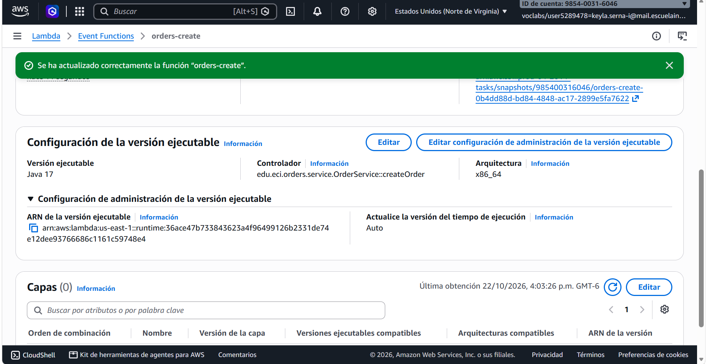

### Invocaciones manuales

Eventos usados (carpeta `events/`):

| Evento | Entrada | Resultado |
|---|---|---|
| `lambda-create-order-1.json` | CUST-42, MacBook Air, 1 | Pedido `ORD-001` creado. |
| (misma prueba repetida) | CUST-42, MacBook Air, 1 | Pedido `ORD-002`: Lambda reutilizó la misma instancia de `OrderService` en memoria. |
| `lambda-create-order-2.json` | CUST-100, Keyboard, 3 | Pedido creado con el siguiente id y los datos enviados. |
| `lambda-create-order-invalid.json` | quantity = 0 | Error: `errorType = edu.eci.orders.exception.InvalidOrderException`, `errorMessage = "quantity must be greater than 0"` y `stackTrace`. |

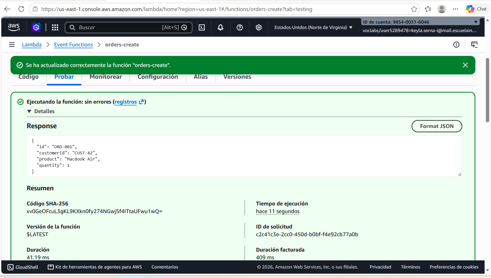
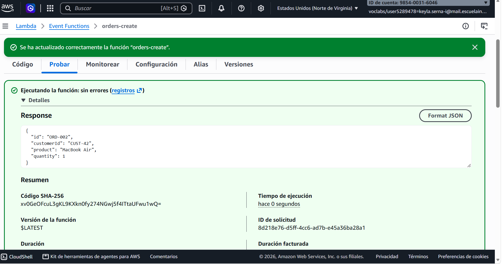
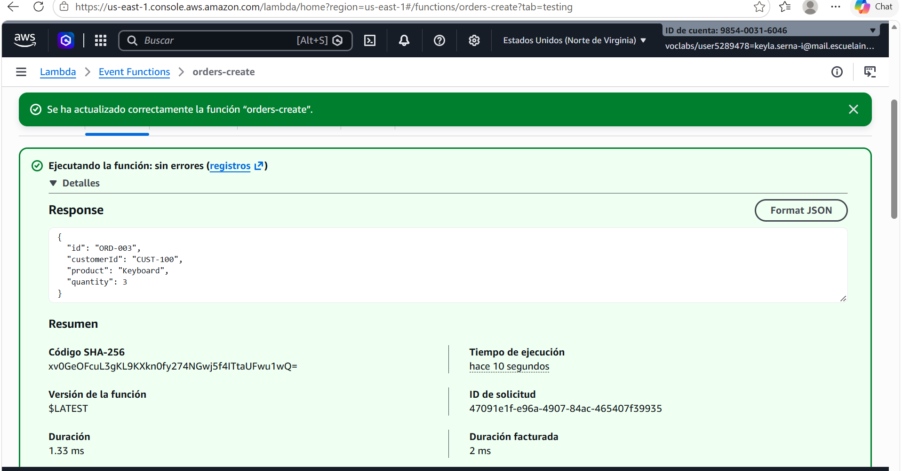
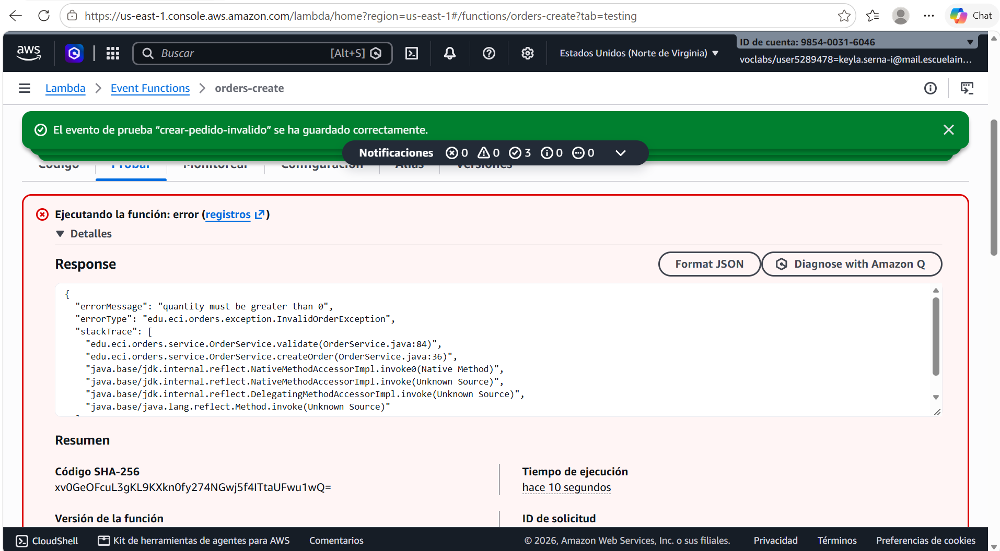

### Investigación: ¿cómo convierte Lambda JSON ↔ Java?

1. **Handler.** El runtime de Java lee el handler (`Clase::método`), carga la clase desde el JAR y crea una instancia con su **constructor sin argumentos**.
2. **JSON → objeto.** Revisa el **tipo del parámetro** del método (`CreateOrderRequest`) y, con su serializador interno (basado en Jackson), crea el objeto y llena cada campo con los **setters** cuyos nombres coinciden con las claves del JSON (`customerId` → `setCustomerId`).
3. **Invocación.** Llama al método por **reflexión**. Se ve en el stack trace: `java.lang.reflect.Method.invoke` → `OrderService.createOrder`.
4. **Objeto → JSON.** Convierte el `Order` devuelto en JSON usando sus **getters** (`getId` → `"id"`).
5. **Errores.** Si el método lanza una excepción, Lambda devuelve un JSON con `errorMessage`, `errorType` y `stackTrace`. **No hay código de estado HTTP**, porque Lambda no conoce HTTP. Además, el stack trace expone detalles internos, algo que una API pública no debería mostrar.
6. **Instancia reutilizada.** La instancia de `OrderService` se conserva mientras el entorno de ejecución siga activo. Por eso el id aumentó de `ORD-001` a `ORD-002`. Cuando Lambda crea un entorno nuevo, los datos se pierden: la memoria **no** es almacenamiento persistente.

**Verificación:** las pruebas en la Lambda desplegada coinciden con la explicación. El JSON se convirtió en el pedido esperado, el id aumentó al repetir la invocación y la excepción se convirtió en un JSON de error sin código HTTP.

### Punto de control 2 — Diagrama

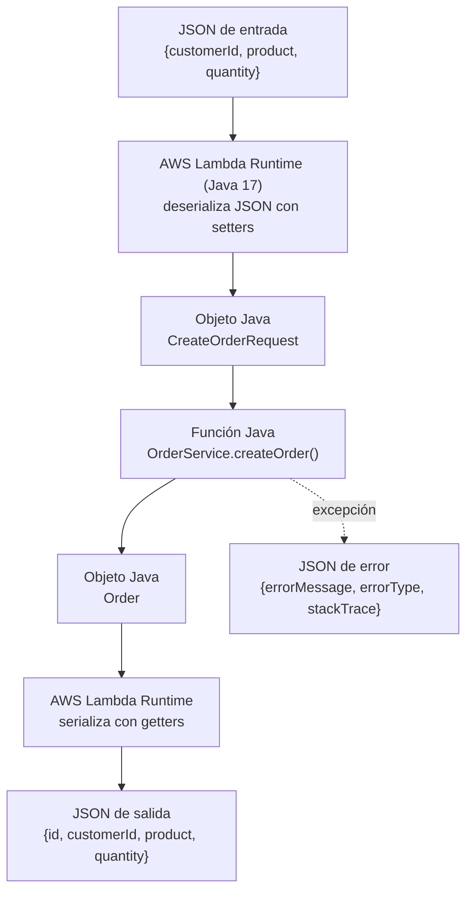
## 5. Partes III y IV — Arquitectura A: API Gateway con plantillas de mapeo (no proxy)

### Lambdas

Se usa **una Lambda por operación**, todas con el mismo JAR. La clase `OrderFunctions` es el punto de entrada: recibe objetos Java normales y llama a `OrderService`, sin usar clases de AWS.

| Lambda | Handler |
|---|---|
| `orders-create` | `edu.eci.orders.lambda.OrderFunctions::createOrder` |
| `orders-get` | `edu.eci.orders.lambda.OrderFunctions::getOrder` |
| `orders-find` | `edu.eci.orders.lambda.OrderFunctions::findOrdersByCustomer` |

Cada Lambda arranca con 3 pedidos de ejemplo (`ORD-001`, `ORD-002` de `CUST-42` y `ORD-003` de `CUST-100`), porque **cada Lambda tiene su propia memoria**: un pedido creado en `orders-create` no existe en `orders-get`.

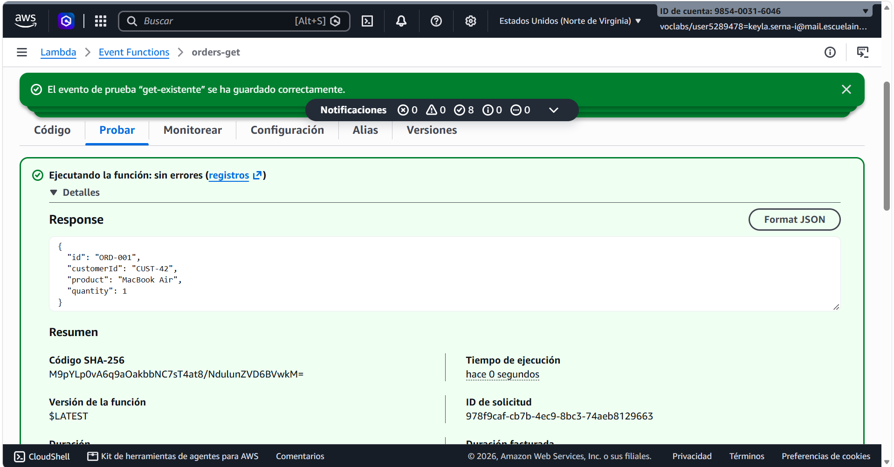
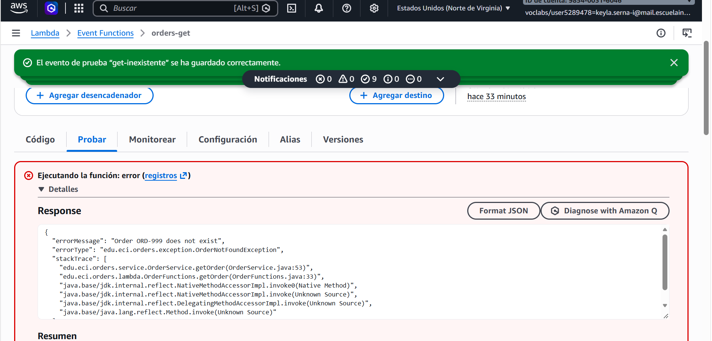
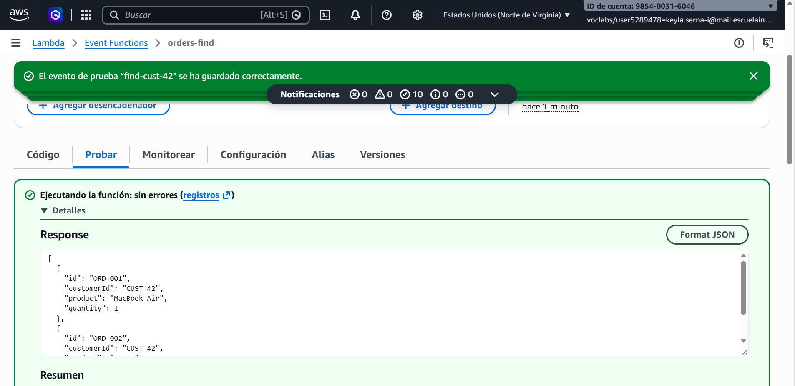
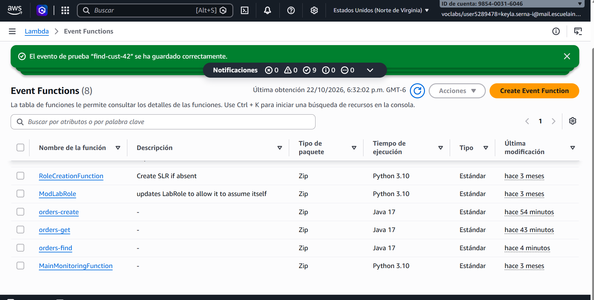

### API Gateway (REST API `orders-api`, etapa `dev`)

URL base: `https://4b8elxuge2.execute-api.us-east-1.amazonaws.com/dev`

```
/
└── /orders              GET  → orders-find
    │                    POST → orders-create
    └── /{id}            GET  → orders-get
```

Todas las integraciones son **Lambda no proxy**. Las plantillas están en la carpeta `apigateway/`:

| Método | Solicitud de integración (entrada) | Respuesta de integración (salida) |
|---|---|---|
| `GET /orders/{id}` | `get-order-request.vtl` → `{"id": "..."}` | Predeterminado → 200. Regex `.*does not exist.*` → **404** con `get-order-404-response.vtl` |
| `GET /orders?customerId=` | `find-orders-request.vtl` → `{"customerId": "..."}` | Predeterminado → 200. Regex `.*customerId is required.*` → **400** con `find-orders-400-response.vtl` |
| `POST /orders` | `create-order-request.vtl` (pasa el cuerpo tal cual) | Predeterminado → **201** + header `Location` (`create-order-201-response.vtl`). Regex `.*(is required\|must be greater than 0).*` → **400** con `create-order-400-response.vtl` |

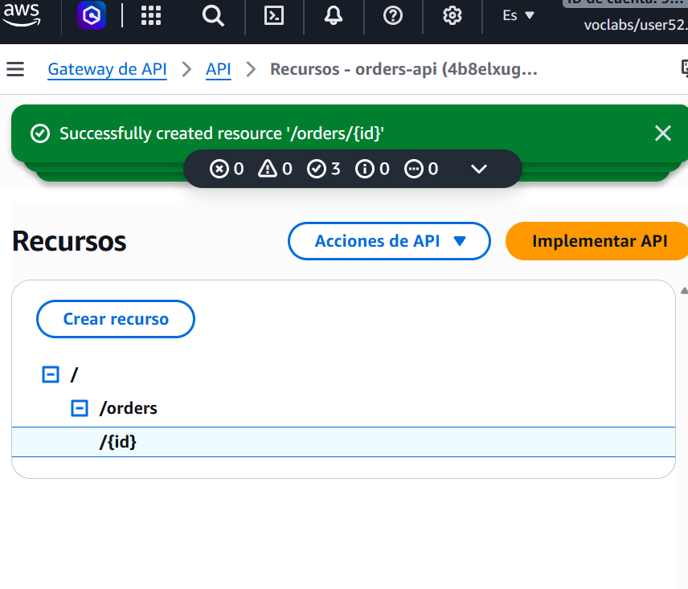
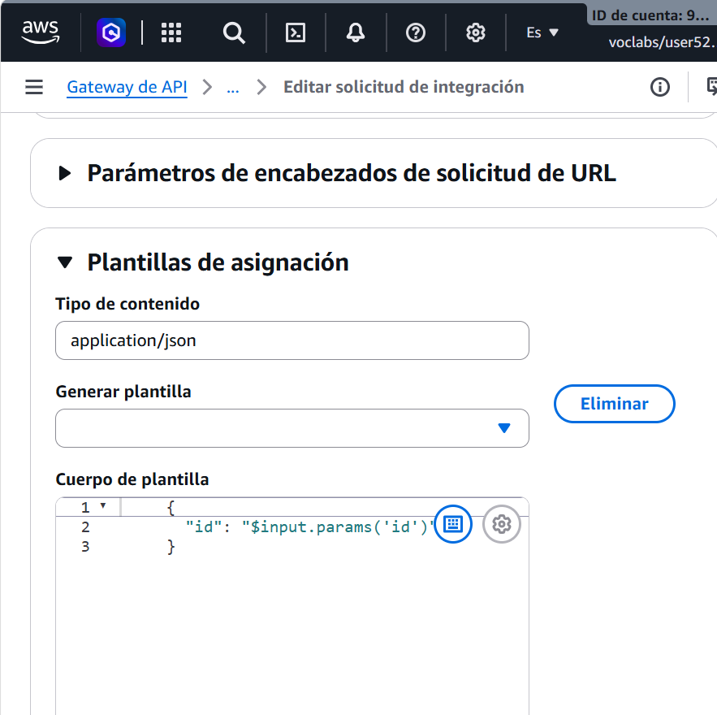
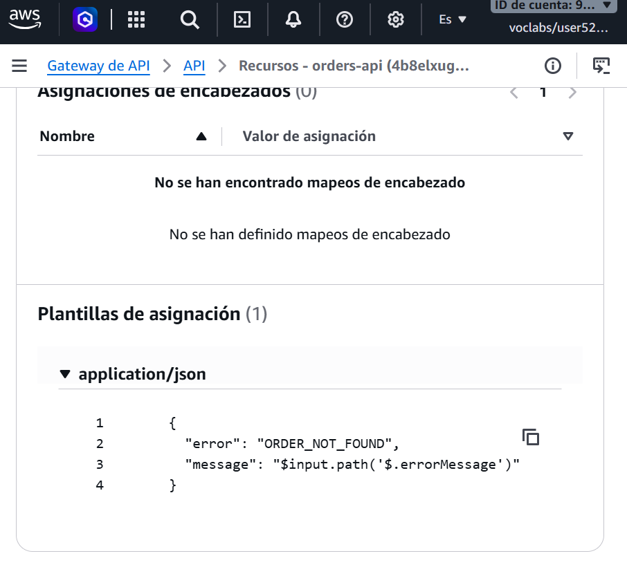

### Pruebas con curl

```bash
BASE=https://4b8elxuge2.execute-api.us-east-1.amazonaws.com/dev

curl -i $BASE/orders/ORD-001                       # 200
curl -i $BASE/orders/ORD-999                       # 404
curl -i "$BASE/orders?customerId=CUST-42"          # 200 (2 pedidos)
curl -i "$BASE/orders?customerId=CUST-100"         # 200 (1 pedido)
curl -i $BASE/orders                               # 400
curl -i -X POST -H "Content-Type: application/json" --data @events/lambda-create-order-1.json $BASE/orders        # 201
curl -i -X POST -H "Content-Type: application/json" --data @events/lambda-create-order-invalid.json $BASE/orders  # 400
```

| Prueba | Resultado |
|---|---|
| `GET /orders/ORD-001` | `200 OK` + pedido |
| `GET /orders/ORD-999` | `404 Not Found` + `{"error":"ORDER_NOT_FOUND","message":"Order ORD-999 does not exist"}` |
| `GET /orders?customerId=CUST-42` | `200 OK` + `[ORD-001, ORD-002]` |
| `GET /orders?customerId=CUST-100` | `200 OK` + `[ORD-003]` |
| `GET /orders` | `400 Bad Request` + `{"error":"MISSING_CUSTOMER_ID","message":"customerId is required"}` |
| `POST /orders` válido | `201 Created` + `Location: /orders/ORD-005` + pedido |
| `POST /orders` con `quantity: 0` | `400 Bad Request` + `{"error":"INVALID_REQUEST","message":"quantity must be greater than 0"}` |


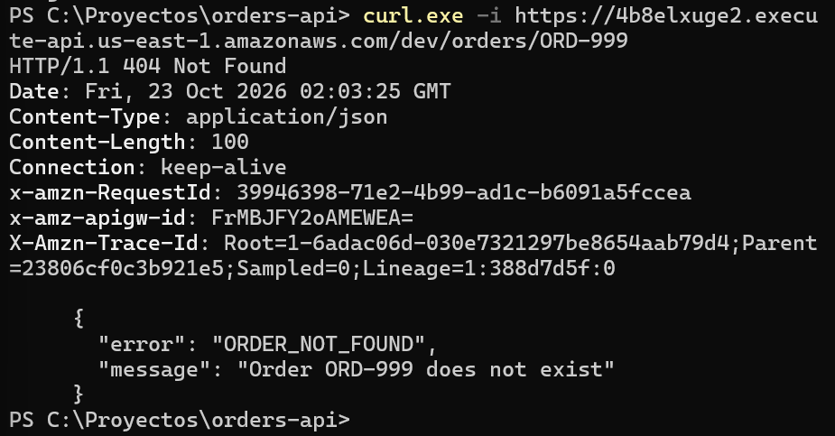
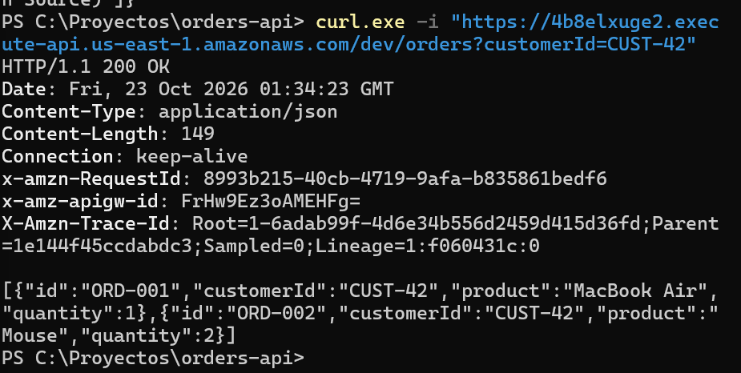
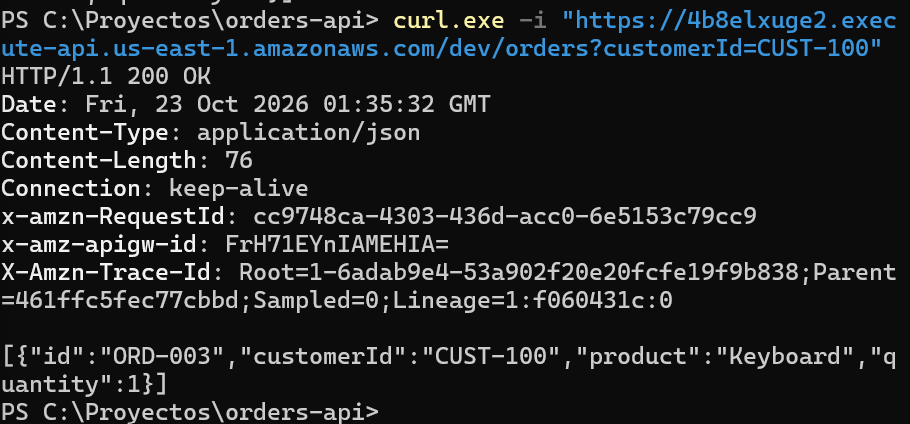
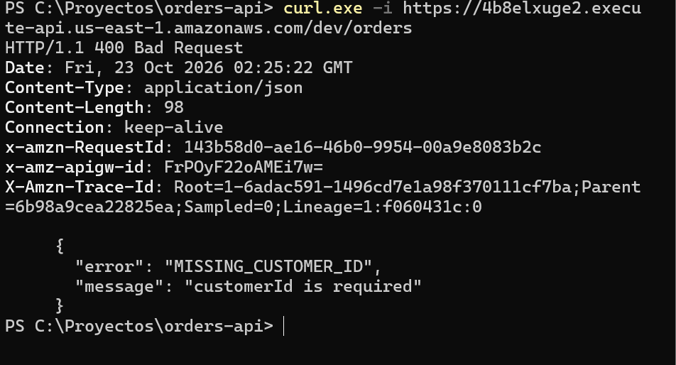
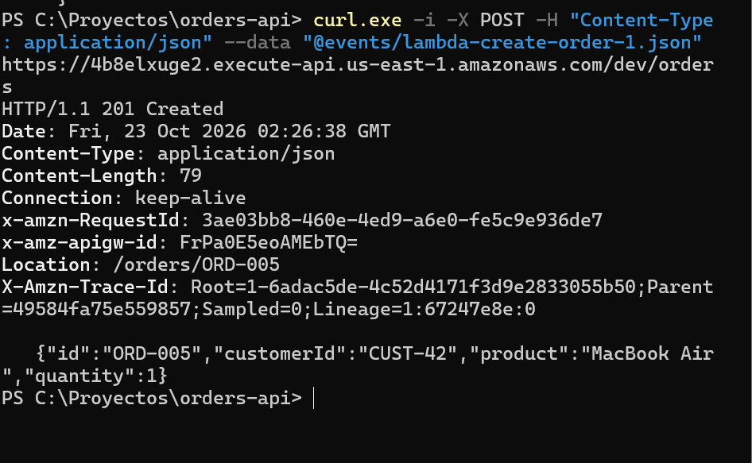
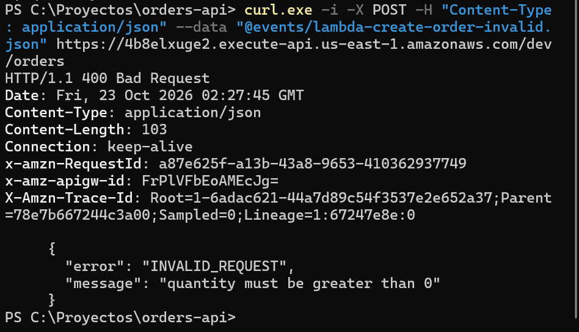

### Observaciones durante la implementación

- Antes de configurar las respuestas, un error de Java llegaba al cliente con **`200 OK`** y con todo el `stackTrace`. En la integración no proxy, API Gateway responde 200 por defecto aunque Lambda indique `X-Amz-Function-Error: Unhandled`.
- Cuando faltaba la plantilla de solicitud, el registro mostraba `Endpoint request body after transformations:` vacío y Java recibía los campos en `null`.
- Después de reiniciar el entorno, los ids volvieron a empezar (de `ORD-006` a `ORD-004`): la memoria de Lambda es **efímera**.

## 6. Punto de control 3 — Responsabilidades de API Gateway (Arquitectura A)

En esta arquitectura, API Gateway es responsable de:

| Responsabilidad | Cómo se hace |
|---|---|
| **Enrutamiento** | El árbol de recursos y métodos decide qué Lambda se invoca. |
| **Extraer parámetros de ruta** | `$input.params('id')` en la plantilla de solicitud. |
| **Extraer parámetros de consulta** | `$input.params('customerId')` en la plantilla de solicitud. |
| **Transformar solicitudes** | Plantillas VTL que construyen el JSON que espera Java. |
| **Transformar respuestas** | Plantillas de respuesta que convierten el error de Lambda al formato `{error, message}` y ocultan el `stackTrace`. |
| **Elegir códigos de estado** | Respuestas de método (200, 201, 400, 404) y `responseOverride.status = 201`. |
| **Mapear errores** | Expresiones regulares sobre `errorMessage` (`.*does not exist.*` → 404, etc.). |
| **Headers** | `Location` se agrega con `responseOverride.header`. |

Java solo hace la lógica de negocio: validar, crear y buscar pedidos.

### Ventajas

- La lógica Java queda **totalmente libre de HTTP y de AWS**: `OrderService` y `OrderFunctions` usan objetos Java normales y se prueban con JUnit sin simular nada.
- El contrato HTTP (rutas, parámetros, códigos) se puede cambiar **sin recompilar ni volver a desplegar** el JAR.
- Cada Lambda es pequeña y se puede escalar, monitorear o dar permisos por separado.

### Desventajas

- **La lógica queda repartida**: para entender qué devuelve `GET /orders/ORD-999` hay que revisar el código Java **y** varias pantallas de la consola (solicitud, respuesta de método, respuesta de integración, plantillas).
- **El mapeo de errores depende del texto del mensaje**: si alguien cambia `"does not exist"` en Java, el 404 deja de funcionar sin que falle ninguna prueba unitaria. Hay un acoplamiento oculto entre Java y la configuración.
- **Difícil de probar localmente**: las plantillas VTL y las regex solo se pueden probar en AWS.
- **Errores inesperados no cubiertos**: un error que no coincida con ninguna regex (por ejemplo un JSON mal formado o un `NullPointerException`) cae en la respuesta predeterminada, que en el POST devuelve **201**. Habría que agregar más reglas para responder 500.
- **Mucha configuración manual y repetitiva**: cada operación necesita su método, su plantilla de entrada, sus respuestas de método y sus respuestas de integración. Fue fácil equivocarse (por ejemplo, poner una plantilla en el método equivocado).
- **Una Lambda por operación con memoria separada**: un pedido creado con POST no puede consultarse con GET, porque cada Lambda tiene sus propios datos en memoria.
## 7. Parte V — Arquitectura B: integración Lambda proxy + adaptador HTTP

### Evento que API Gateway envía a Lambda

Con la integración proxy, API Gateway **no transforma nada**: envía a Lambda la petición HTTP completa como JSON. Ejemplo real (con datos personales reemplazados por `XXXX`): [`events/apigateway-proxy-get-order.json`](events/apigateway-proxy-get-order.json).

| Información | Dónde aparece en el evento | Ejemplo |
|---|---|---|
| Método HTTP | `httpMethod` | `"GET"` |
| Ruta | `path` (ruta real) y `resource` (plantilla) | `"/orders/ORD-001"`, `"/orders/{id}"` |
| Parámetros de ruta | `pathParameters` | `{"id": "ORD-001"}` |
| Parámetros de consulta | `queryStringParameters` (y `multiValueQueryStringParameters`) | `{"customerId": "CUST-42"}` |
| Headers | `headers` (y `multiValueHeaders`) | `{"Content-Type": "application/json"}` |
| Cuerpo | `body`, **como texto** (y `isBase64Encoded`) | `"{\"customerId\":\"CUST-42\",...}"` |

Lambda debe responder con `{"statusCode": ..., "headers": {...}, "body": "..."}`. API Gateway usa ese `statusCode` como código HTTP real.

### Adaptador HTTP

```
API Gateway (proxy) ──evento──> OrdersHttpHandler ──objetos Java──> OrderService
                                 (conoce HTTP y AWS)                 (Java normal, sin cambios)
```

| Lambda | `orders-http` |
|---|---|
| Runtime | Java 17, 512 MB, timeout 15 s |
| Handler | `edu.eci.orders.http.OrdersHttpHandler::handleRequest` |
| API Gateway | `orders-api-proxy` (`https://3wzew6a30d.execute-api.us-east-1.amazonaws.com/dev`), los 3 métodos en modo **proxy** hacia la misma Lambda |

`OrdersHttpHandler` es la **única** clase que conoce HTTP y AWS. Se encarga de:
- **enrutar** según `httpMethod` + `resource`;
- **extraer** `pathParameters`, `queryStringParameters` y `body`;
- **convertir** el JSON del cuerpo a `CreateOrderRequest` (Jackson);
- **decidir el código HTTP**: `OrderNotFoundException` → 404, otras `OrderException` → 400, JSON mal formado → 400, cualquier otro error → **500** (sin mostrar detalles internos);
- agregar el header **`Location`** al crear.

`Order`, `CreateOrderRequest`, las excepciones y `OrderService` **no cambiaron**.

### Pruebas

**Locales (sin AWS):** `OrdersHttpHandlerTest` tiene 10 pruebas que crean eventos de API Gateway en Java y revisan el código HTTP y el JSON de respuesta, incluido el caso 500. En total, `mvn test` ejecuta 25 pruebas.

**Desplegadas:**

```bash
BASE=https://3wzew6a30d.execute-api.us-east-1.amazonaws.com/dev
curl -i $BASE/orders/ORD-001                       # 200
curl -i $BASE/orders/ORD-999                       # 404
curl -i "$BASE/orders?customerId=CUST-42"          # 200
curl -i $BASE/orders                               # 400
curl -i -X POST -H "Content-Type: application/json" --data @events/lambda-create-order-1.json $BASE/orders        # 201
curl -i -X POST -H "Content-Type: application/json" --data @events/lambda-create-order-invalid.json $BASE/orders  # 400
curl -i -X POST -H "Content-Type: application/json" --data "{not json" $BASE/orders                               # 400
```

| Prueba | Resultado |
|---|---|
| `GET /orders/ORD-001` | `200 OK` + pedido |
| `GET /orders/ORD-999` | `404` + `{"error":"ORDER_NOT_FOUND","message":"Order ORD-999 does not exist"}` |
| `GET /orders?customerId=CUST-42` | `200 OK` + 2 pedidos |
| `GET /orders` | `400` + `{"error":"MISSING_CUSTOMER_ID","message":"customerId is required"}` |
| `POST /orders` válido | `201 Created` + `Location: /orders/ORD-005` |
| `POST /orders` con `quantity: 0` | `400` + `{"error":"INVALID_REQUEST","message":"quantity must be greater than 0"}` |
| `POST /orders` con JSON mal formado | `400` + `{"error":"INVALID_REQUEST","message":"Malformed JSON body"}` |
| `GET /orders/ORD-005` (recién creado) | `200 OK`: como hay una sola Lambda, el pedido creado con POST **sí** se puede consultar |


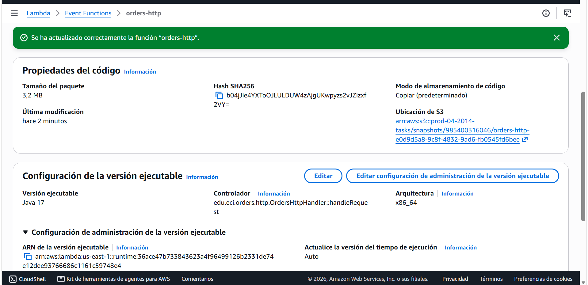
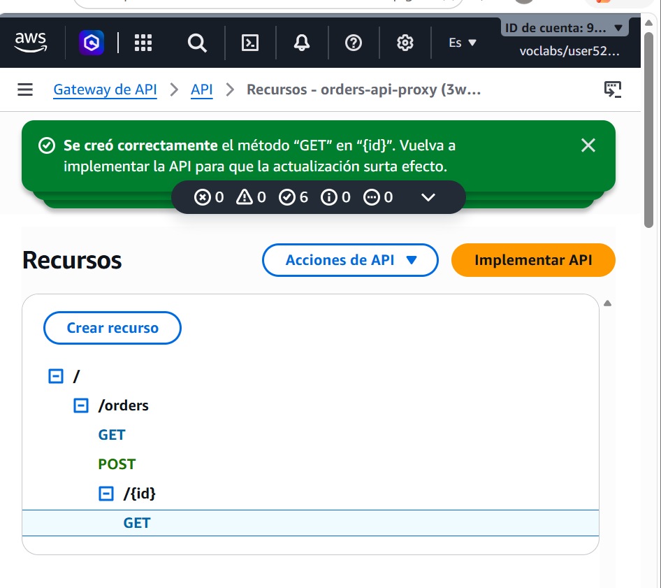
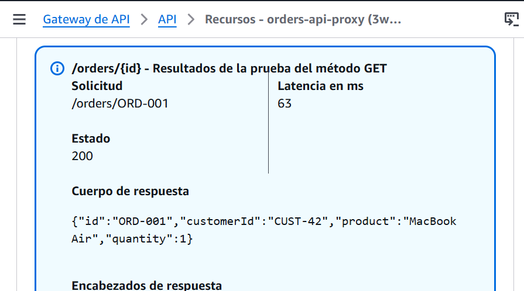
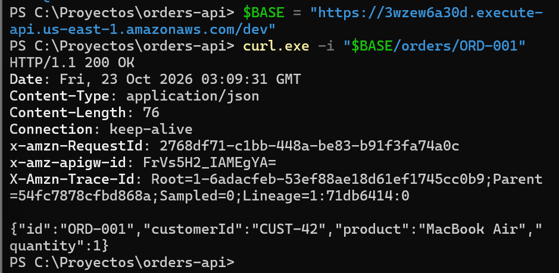
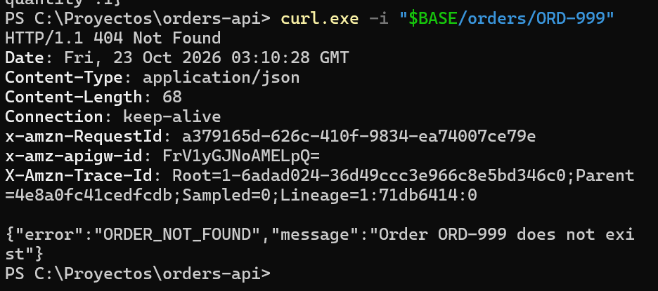
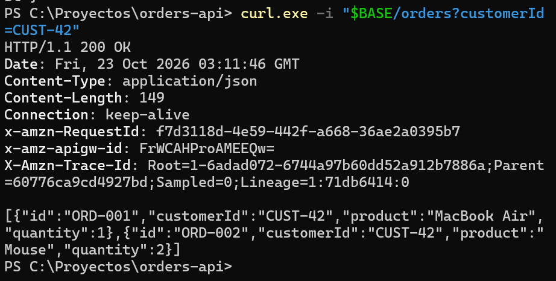
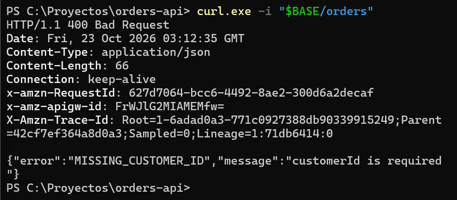
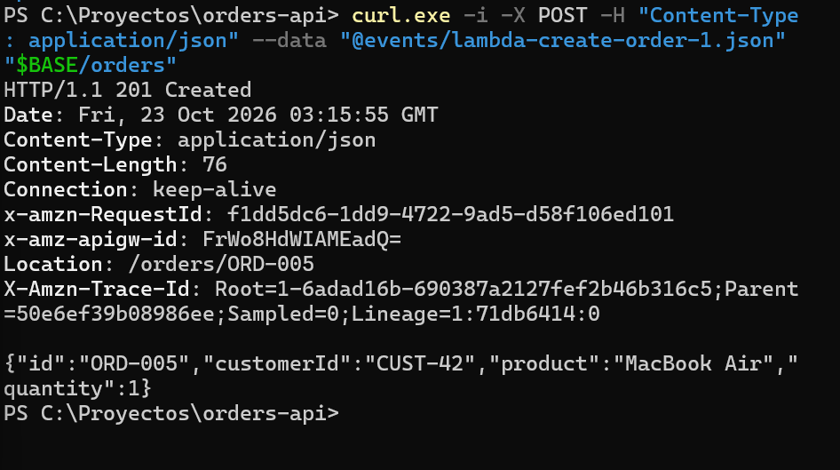
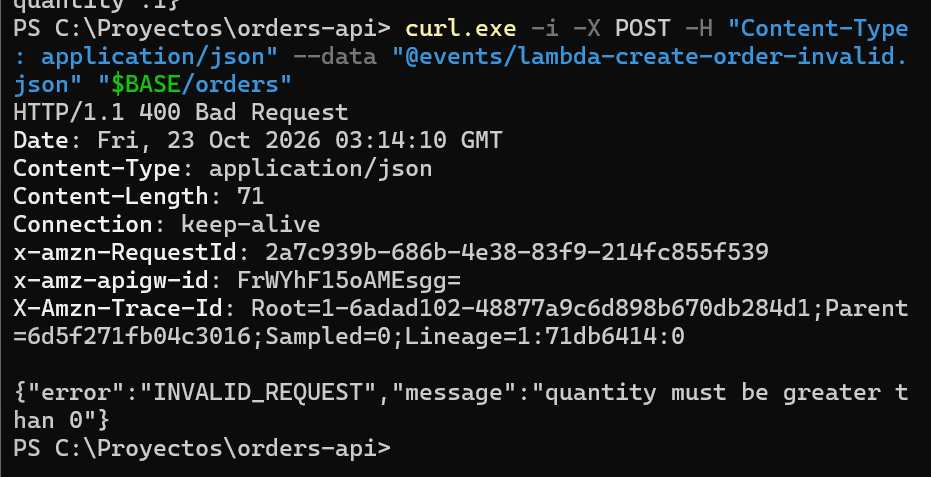
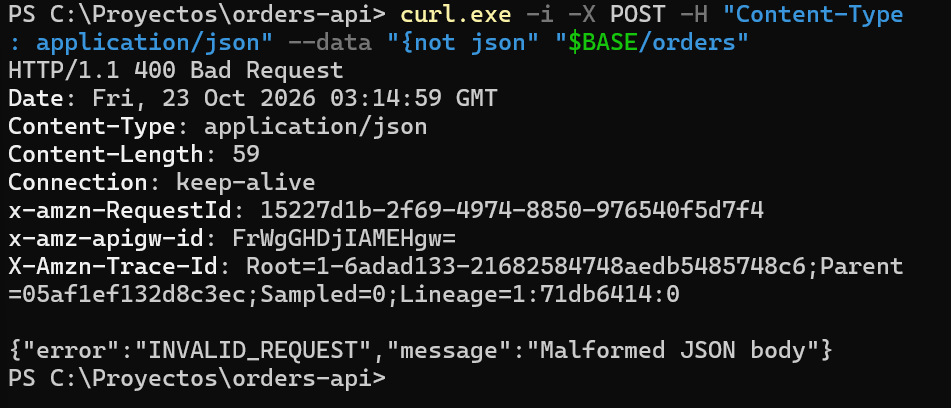


## 8. Comparación de las dos arquitecturas

| Pregunta | A — Transformación en API Gateway | B — Proxy + adaptador HTTP |
|---|---|---|
| **¿Cuál requirió más configuración de API Gateway?** | **A.** Por cada método: plantilla de solicitud, respuestas de método (200/201/400/404), respuestas de integración con regex y plantillas de respuesta. | Solo recursos, métodos y el interruptor "proxy". |
| **¿Cuál requirió más código Java de infraestructura?** | Muy poco: `OrderFunctions` (3 métodos de una línea). | **B.** `OrdersHttpHandler` (enrutamiento, parámetros, JSON, códigos) y dependencias de AWS y Jackson. |
| **¿Cuál fue más fácil de probar localmente?** | Solo la lógica Java. Las plantillas VTL y las regex solo se pueden probar en AWS. | **B.** Todo el comportamiento HTTP (200, 201, 400, 404, 500) se prueba con JUnit en `OrdersHttpHandlerTest`. |
| **¿Dónde se definen los códigos HTTP?** | En la **consola de API Gateway**: respuestas de método, regex sobre `errorMessage` y `responseOverride.status`. | En **Java**, dentro de `OrdersHttpHandler` (`json(404, ...)`, `json(201, ...)`). |
| **¿Qué pasa si la API crece de 3 a 30 operaciones?** | ~30 Lambdas (o métodos) y por cada una varias plantillas y regex hechas a mano: difícil de mantener y fácil de equivocarse. Cada Lambda tiene memoria separada. | Una Lambda; se agregan ramas en el adaptador. El enrutamiento manual con `if` se volvería largo y convendría separarlo (una clase por recurso o una tabla de rutas). Una sola Lambda grande también tiene más arranque en frío y un solo conjunto de permisos. |
| **¿Cuál deja más limpia la lógica Java?** | Las dos dejan **igual de limpia** a `OrderService`: no cambió en ninguna. En A, ni siquiera el punto de entrada conoce HTTP. | Igual que A para `OrderService`. La parte HTTP vive en una sola clase. |
| **¿Cuál es más fácil de entender para otro desarrollador?** | Para entender un endpoint hay que mirar el código **y** varias pantallas de la consola. El mapeo de errores depende del texto del mensaje (acoplamiento oculto). | Todo está en el repositorio, en código Java que se lee de arriba abajo y tiene pruebas. |
| **¿Cuál elegiría para un sistema más grande? ¿Por qué?** | — | **B**, con dos ajustes: definir la infraestructura como código (SAM/CDK/OpenAPI) y separar el enrutamiento cuando crezca. Razones: el comportamiento HTTP queda versionado en Git, se prueba localmente, maneja el 500 y el JSON mal formado, y no depende de regex sobre mensajes. A tiene sentido si el equipo de plataforma quiere controlar el contrato HTTP desde API Gateway, o para funciones muy simples sin manejo de errores. |

### Lo que se observó en la práctica

- En **A**, la mayoría de los errores fueron de **configuración**: plantillas guardadas en el método equivocado, olvidar volver a desplegar, el 201 que la consola no dejaba seleccionar. Ninguno lo detectaba una prueba.
- En **A**, un pedido creado con `POST` no se podía consultar con `GET`, porque eran Lambdas distintas con memoria distinta. En **B** sí (`ORD-005`).
- En **B**, el único error de configuración fue dejar un método con el proxy apagado, y el registro lo dejó claro (cuerpo vacío y la respuesta `{"statusCode":...}` devuelta literal).
- En **B**, un JSON mal formado responde **400**. En **A** no había regla para ese caso.