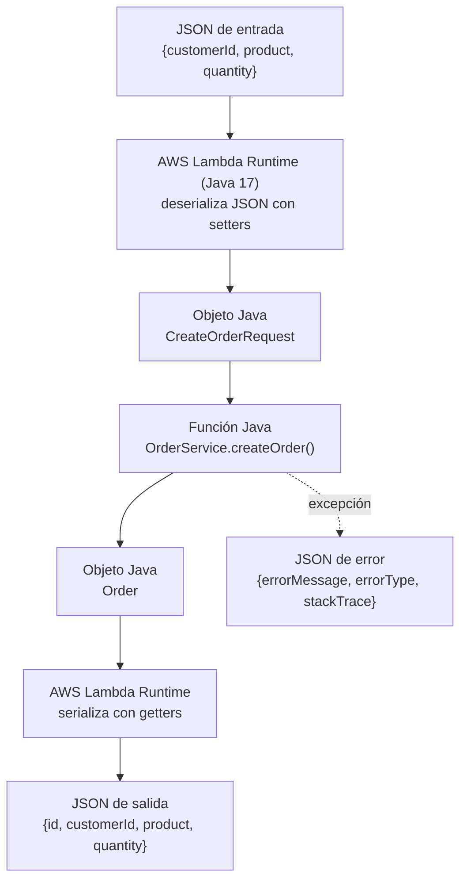

# Orders API — API REST serverless con AWS Lambda y API Gateway

> Entorno: JDK 21 compilando con `maven.compiler.release=17`. Runtime de Lambda: Java 17.

## 1. Diseño de la API (contrato)

### Recurso: pedido (Order)

```json
{
  "id": "ORD-001",
  "customerId": "CUST-42",
  "product": "MacBook Air",
  "quantity": 1
}
```

### Formato de error (igual para todos los errores)

```json
{
  "error": "ORDER_NOT_FOUND",
  "message": "Order ORD-999 does not exist"
}
```

- `error`: código fijo en mayúsculas, para que un programa lo pueda leer.
- `message`: explicación para una persona.

### Operaciones

| Operación | Método | URL | Parámetros | Cuerpo de la petición | Éxito | Errores |
|---|---|---|---|---|---|---|
| Crear pedido | POST | `/orders` | — | `{"customerId","product","quantity"}` | **201 Created** + pedido creado (con `id`) + header `Location: /orders/{id}` | **400** `INVALID_REQUEST` (campos vacíos, quantity ≤ 0, JSON mal formado) · **500** `INTERNAL_ERROR` |
| Obtener pedido | GET | `/orders/{id}` | Ruta: `id` | — | **200 OK** + pedido | **404** `ORDER_NOT_FOUND` · **500** `INTERNAL_ERROR` |
| Buscar por cliente | GET | `/orders?customerId={customerId}` | Consulta: `customerId` | — | **200 OK** + lista de pedidos (puede ser `[]`) | **400** `MISSING_CUSTOMER_ID` · **500** `INTERNAL_ERROR` |
| Eliminar pedido (reto final) | DELETE | `/orders/{id}` | Ruta: `id` | — | **204 No Content** (sin cuerpo) | **404** `ORDER_NOT_FOUND` · **500** `INTERNAL_ERROR` |

### Ejemplos de errores

```json
{ "error": "INVALID_REQUEST", "message": "quantity must be greater than 0" }
```
```json
{ "error": "MISSING_CUSTOMER_ID", "message": "customerId is required" }
```
```json
{ "error": "INTERNAL_ERROR", "message": "Unexpected error" }
```

## 2. Preguntas de diseño

**¿Cuáles son los recursos de la API?**
Un único recurso: los **pedidos** (`/orders`). `/orders` es la colección y `/orders/{id}` es un pedido específico.

**¿Por qué `/orders/{id}` para recuperar un pedido?**
Porque el `id` identifica un recurso único. En REST, la identidad del recurso va en la ruta: `/orders/ORD-42` *es* el pedido ORD-42.

**¿Por qué `customerId` va como parámetro de consulta?**
Porque no identifica un pedido, sino que **filtra** la colección de pedidos. Los filtros sobre una colección se expresan con query parameters (`/orders?customerId=CUST-42`).

**¿Qué devuelve `POST /orders` si tiene éxito?**
**201 Created**, el pedido creado con su `id` generado por el servidor y el header `Location: /orders/{id}` que indica dónde consultarlo.

**¿Qué devuelve la API si el pedido no existe?**
**404 Not Found** con `{"error":"ORDER_NOT_FOUND","message":"Order ORD-999 does not exist"}`.

**¿Qué debe contener una respuesta de error?**
Un código de error fijo (`error`), para que el cliente lo procese, y un mensaje legible (`message`). No debe incluir detalles internos como trazas de Java (*stack traces*).

**Decisión adicional:** si un cliente no tiene pedidos, `GET /orders?customerId=...` devuelve **200** con `[]` y no 404. La búsqueda funcionó, simplemente no hubo resultados.

## 3. Parte I — Aplicación en Java puro

### Estructura

```
src/main/java/edu/eci/orders/
├── model/       Order, CreateOrderRequest
├── exception/   OrderException, InvalidOrderException, OrderNotFoundException
└── service/     OrderService (createOrder, getOrder, getOrdersByCustomer)
src/test/java/edu/eci/orders/service/
└── OrderServiceTest (12 pruebas JUnit)
```

Los pedidos se guardan en memoria (`ConcurrentHashMap`). Los ids se generan como `ORD-001`, `ORD-002`, ...

### Cómo compilar y probar

```bash
mvn test       # ejecuta las pruebas
mvn package    # genera target/orders-api-1.0.jar
```

### Punto de control 1

**¿Se puede probar la funcionalidad sin AWS?**
Sí. `mvn test` ejecuta las 12 pruebas localmente sin conexión a AWS, porque `OrderService` es Java puro.

**¿La aplicación necesita un servidor web?**
No. Es un conjunto de clases Java que se usan llamando métodos normales.

**¿Requiere Spring Boot?**
No. La única dependencia es JUnit, y solo para pruebas.

**¿Qué contiene el JAR generado?**
Las clases compiladas (`.class`) de los paquetes `model`, `exception` y `service`, más `META-INF/MANIFEST.MF`. No incluye las pruebas ni JUnit (scope `test`).

**¿Qué partes de la aplicación conocen HTTP?**
Ninguna. Los errores usan códigos de negocio (`ORDER_NOT_FOUND`, `INVALID_REQUEST`), no códigos HTTP. Convertirlos a 404 o 400 será responsabilidad de una capa posterior (API Gateway o el adaptador HTTP).
## 4. Parte II — Función Java en AWS Lambda

### Configuración

| Campo | Valor |
|---|---|
| Nombre | `orders-create` |
| Región | us-east-1 |
| Runtime | Java 17 (x86_64) |
| Rol | LabRole (AWS Academy) |
| Código | `target/orders-api-1.0.jar` |
| Handler | `edu.eci.orders.service.OrderService::createOrder` |

No fue necesario modificar el código ni agregar dependencias de AWS: Lambda invoca directamente el método `createOrder` de `OrderService`.


### Invocaciones manuales

Eventos usados (carpeta `events/`):

| Evento | Entrada | Resultado |
|---|---|---|
| `lambda-create-order-1.json` | CUST-42, MacBook Air, 1 | Pedido `ORD-001` creado. |
| (misma prueba repetida) | CUST-42, MacBook Air, 1 | Pedido `ORD-002`: Lambda reutilizó la misma instancia de `OrderService` en memoria. |
| `lambda-create-order-2.json` | CUST-100, Keyboard, 3 | Pedido creado con el siguiente id y los datos enviados. |
| `lambda-create-order-invalid.json` | quantity = 0 | Error: `errorType = edu.eci.orders.exception.InvalidOrderException`, `errorMessage = "quantity must be greater than 0"` y `stackTrace`. |


### Investigación: ¿cómo convierte Lambda JSON ↔ Java?

1. **Handler.** El runtime de Java lee el handler (`Clase::método`), carga la clase desde el JAR y crea una instancia con su **constructor sin argumentos**.
2. **JSON → objeto.** Revisa el **tipo del parámetro** del método (`CreateOrderRequest`) y, con su serializador interno (basado en Jackson), crea el objeto y llena cada campo con los **setters** cuyos nombres coinciden con las claves del JSON (`customerId` → `setCustomerId`).
3. **Invocación.** Llama al método por **reflexión**. Se ve en el stack trace: `java.lang.reflect.Method.invoke` → `OrderService.createOrder`.
4. **Objeto → JSON.** Convierte el `Order` devuelto en JSON usando sus **getters** (`getId` → `"id"`).
5. **Errores.** Si el método lanza una excepción, Lambda devuelve un JSON con `errorMessage`, `errorType` y `stackTrace`. **No hay código de estado HTTP**, porque Lambda no conoce HTTP. Además, el stack trace expone detalles internos, algo que una API pública no debería mostrar.
6. **Instancia reutilizada.** La instancia de `OrderService` se conserva mientras el entorno de ejecución siga activo. Por eso el id aumentó de `ORD-001` a `ORD-002`. Cuando Lambda crea un entorno nuevo, los datos se pierden: la memoria **no** es almacenamiento persistente.

**Verificación:** las pruebas en la Lambda desplegada coinciden con la explicación. El JSON se convirtió en el pedido esperado, el id aumentó al repetir la invocación y la excepción se convirtió en un JSON de error sin código HTTP.

### Punto de control 2 — Diagrama

