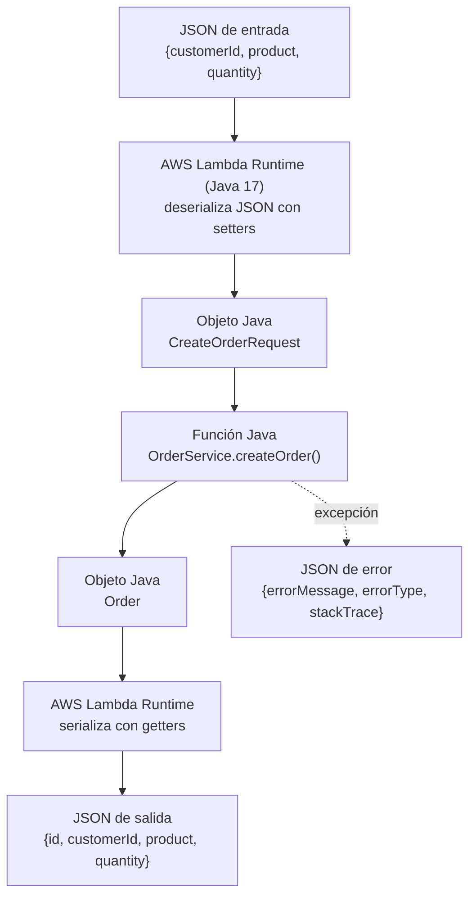

## 4. Parte II — Función Java en AWS Lambda

### Configuración

| Campo | Valor |
|---|---|
| Nombre | `orders-create` |
| Región | us-east-1 |
| Runtime | Java 17 (x86_64) |
| Rol | LabRole (AWS Academy) |
| Código | `target/orders-api-1.0.jar` |
| Handler | `edu.eci.orders.service.OrderService::createOrder` |

No fue necesario modificar el código ni agregar dependencias de AWS: Lambda invoca directamente el método `createOrder` de `OrderService`.

### Invocaciones manuales

Eventos usados (carpeta `events/`):

| Evento | Entrada | Resultado |
|---|---|---|
| `lambda-create-order-1.json` | CUST-42, MacBook Air, 1 | Pedido `ORD-001` creado. |
| (misma prueba repetida) | CUST-42, MacBook Air, 1 | Pedido `ORD-002`: Lambda reutilizó la misma instancia de `OrderService` en memoria. |
| `lambda-create-order-2.json` | CUST-100, Keyboard, 3 | Pedido creado con el siguiente id y los datos enviados. |
| `lambda-create-order-invalid.json` | quantity = 0 | Error: `errorType = edu.eci.orders.exception.InvalidOrderException`, `errorMessage = "quantity must be greater than 0"` y `stackTrace`. |

### Investigación: ¿cómo convierte Lambda JSON ↔ Java?

1. **Handler.** El runtime de Java lee el handler (`Clase::método`), carga la clase desde el JAR y crea una instancia con su **constructor sin argumentos**.
2. **JSON → objeto.** Revisa el **tipo del parámetro** del método (`CreateOrderRequest`) y, con su serializador interno (basado en Jackson), crea el objeto y llena cada campo con los **setters** cuyos nombres coinciden con las claves del JSON (`customerId` → `setCustomerId`).
3. **Invocación.** Llama al método por **reflexión**. Se ve en el stack trace: `java.lang.reflect.Method.invoke` → `OrderService.createOrder`.
4. **Objeto → JSON.** Convierte el `Order` devuelto en JSON usando sus **getters** (`getId` → `"id"`).
5. **Errores.** Si el método lanza una excepción, Lambda devuelve un JSON con `errorMessage`, `errorType` y `stackTrace`. **No hay código de estado HTTP**, porque Lambda no conoce HTTP. Además, el stack trace expone detalles internos, algo que una API pública no debería mostrar.
6. **Instancia reutilizada.** La instancia de `OrderService` se conserva mientras el entorno de ejecución siga activo. Por eso el id aumentó de `ORD-001` a `ORD-002`. Cuando Lambda crea un entorno nuevo, los datos se pierden: la memoria **no** es almacenamiento persistente.

**Verificación:** las pruebas en la Lambda desplegada coinciden con la explicación. El JSON se convirtió en el pedido esperado, el id aumentó al repetir la invocación y la excepción se convirtió en un JSON de error sin código HTTP.

### Punto de control 2 — Diagrama

